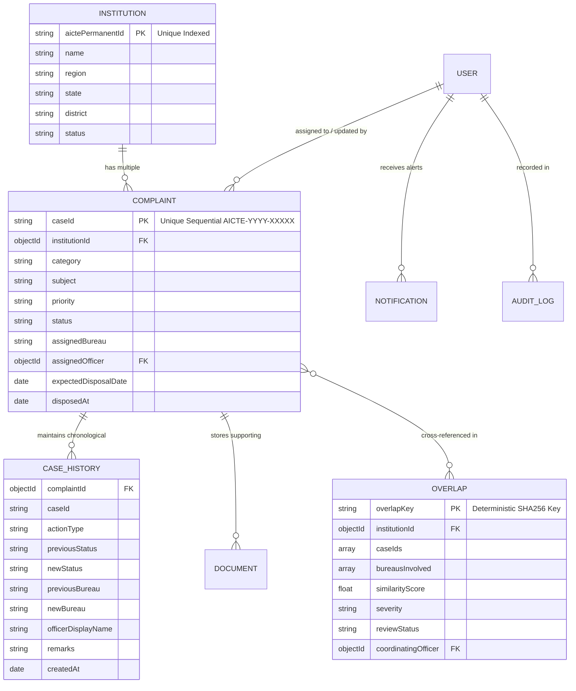

# System Architecture: Integrated Institution Complaint Monitoring & Overlap Dashboard

## 1. Overview
The Integrated Institution Complaint Monitoring and Status Dashboard provides AICTE officials with a centralized regulatory monitoring system across the Regulation Bureau (RB), Public Grievance Redressal Cell (PGRC), Approval Bureau, Finance Bureau, and Regional Offices.

Its core innovation is an **Automated Cross-Bureau Overlap Detection Engine** that detects concurrent grievances filed against the same technical institution across different bureaus, preventing conflicting decisions and duplicated regulatory visits.

---

## 2. Tiered System Architecture

```
[ Client Presentation Layer ]
  React.js (v18) + Tailwind CSS + Lucide React + Recharts + Vite
  - Responsive government dashboard design system (Navy/White theme)
  - Role-gated views (Super Admin, Senior Advisor, Bureau Officer, Regional Officer, Auditor)
  - Interactive charts (monthly inflow vs disposal, bureau workload, regional spread, ageing)
  - Prominent cross-bureau overlap alert banners
            │
            │ RESTful HTTP / JSON (Bearer JWT)
            ▼
[ API Application Server Layer ]
  Node.js (v24) + Express.js
  - Helmet security headers, CORS origin protection, Express-Validator
  - JWT Authentication & Role-Based Access Control (RBAC)
  - Overlap Detection Engine (Multi-pass token Jaccard similarity & synergy matrix)
  - Concurrency-safe atomic Case ID sequence generator (`AICTE-2026-XXXXX`)
  - Chronological append-only Case Action History logger
  - Statutory deadline & overdue background alert runner
  - Multer upload storage with mime validation
            │
            │ Mongoose ODM (Object-Document Mapper)
            ▼
[ Persistence & Database Layer ]
  MongoDB (Atlas / Community)
  - Indexed collections: Users, Institutions, Complaints, CaseHistories, Overlaps, Notifications, AuditLogs, Documents, Counters
```

---

## 3. Database Collection Relationships



---

## 4. Cross-Bureau Overlap Detection Algorithm

1. **Triggering Events**:
   - Complaint Registration (`POST /api/complaints`)
   - Bureau Transfer (`PATCH /api/complaints/:id/transfer`)
   - Manual System Scan (`POST /api/overlaps/scan`)

2. **Detection Logic**:
   - **Filter 1: Active Cases per Institution**:
     $$\text{ActiveComplaints}(I) = \{ c \in \text{Complaints} \mid c.\text{institutionId} = I \land c.\text{status} \notin \{\text{'Disposed'}, \text{'Closed'}\} \}$$
   - **Filter 2: Cross-Bureau Divergence**:
     If $c_1.\text{assignedBureau} \neq c_2.\text{assignedBureau}$, flag cross-bureau condition.
   - **Filter 3: Text Jaccard Similarity**:
     $$\text{Tokens}(t) = \text{Stem}(\text{Normalize}(t)) \setminus \text{Stopwords}$$
     $$J(c_1, c_2) = \frac{|\text{Tokens}(c_1) \cap \text{Tokens}(c_2)|}{|\text{Tokens}(c_1) \cup \text{Tokens}(c_2)|}$$
   - **Filter 4: Category Synergy Matrix**:
     Evaluates high-correlation regulatory pairs:
     - `('Infrastructure', 'Regulatory Compliance')`
     - `('Admission and Fee Issues', 'Student Grievances')`
     - `('Faculty and Staffing', 'Academic Issues')`
   - **Severity Scoring**:
     - **High Severity**: Cross-Bureau divergence + ($J \ge 0.25$ OR Category Synergy match OR Previously Linked).
     - **Medium Severity**: Same institution + Different Bureaus + Active cases.
     - **Low Severity**: Same bureau + Correlated allegations.
   - **Deduplication Key**:
     $$\text{Key} = \text{SHA256}(I.\text{id} + \text{Sorted}(\{c_1.\text{caseId}, c_2.\text{caseId}\}))$$
     Guarantees that repeated evaluation does not spawn duplicate unreviewed alerts.

---

## 5. Security & Compliance Architecture

- **Password Hashing**: Salted bcrypt (10 rounds).
- **Session Tokens**: Stateless signed JWTs with 7-day expiration and automated 401 client interceptor.
- **Role-Based Authorization (RBAC)**: Enforced via Express middleware on every endpoint before controller execution.
- **Immutable Audit Logging**: Every critical action (`LOGIN`, `CREATE_COMPLAINT`, `TRANSFER`, `ESCALATE`, `DISPOSE`, `OVERLAP_RESOLVE`) is logged to `AuditLogs` with sanitized metadata.
- **Safe Sequence Generation**: Atomic MongoDB findOneAndUpdate counter increments prevent race conditions and duplicate Case IDs under concurrent load.
